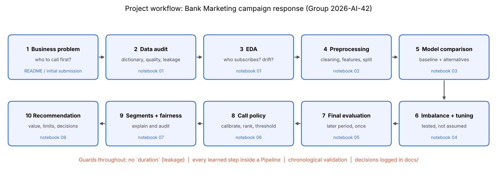

# Workflow

Regenerate with `python -m src.evaluation.workflow_diagram`.

| Step | What happens | Evidence produced | Decision recorded |
|---|---|---|---|
| 1 Business problem | A call centre can only phone a fraction of the list: who first? | problem framing canvas (README) | D1, D2 |
| 2 Data audit | Dictionary, availability audit, quality scorecard | notebook 01 §2-3 | D3, D4, D5 |
| 3 EDA | Subscriber profile, history, contact pressure, drift, redundancy | notebook 01 §4-12 | insight log E1-E12 |
| 4 Preprocessing | Cleaning, encoding, features, chronological split, leakage checks | notebook 02 | P1-P12 |
| 5 Model comparison | Dummy + LR + RF + boosting + MLP, then challengers; data version | notebook 03 | D9, D11, D13 |
| 6 Imbalance + tuning | Weights / SMOTE / SMOTE-Tomek tested; tuning on forward-chaining folds | notebook 04 | D8 |
| 7 Final evaluation | One look at the later period; random-split optimism measured | notebook 05 | D7 |
| 8 Call policy | Recalibrate, rank, threshold, operating points | notebook 06 | D10, D14 |
| 9 Segments + fairness | Segment priorities, TreeSHAP, fairness audit | notebook 07 | D15, D16 |
| 10 Recommendation | Value, limitations, reproducibility | notebook 08 | D9, D16 |
